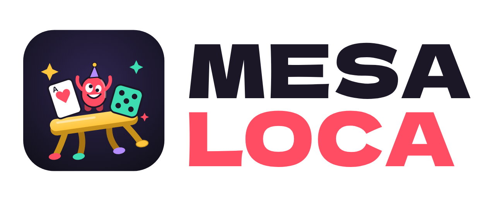

# Mesa Loca

<picture>
  <source media="(prefers-color-scheme: dark)" srcset="img/logo-horizontal.png">
  
</picture>

Juegos de fiesta para jugar con amigos, en un solo teléfono o cada uno en el suyo (online): El Impostor, Mesa del Mentiroso, Detectives, Chinchón, Batalla naval, Ajedrez, La Nave, la Arena y los trabajos diarios.

Logo e íconos en `img/` (`icono.svg`, `icono-512.png`, `logo-horizontal.png`, `logo-horizontal-oscuro.png`, `logo-vertical.png`).

**Jugar:** https://nachobracco1595.github.io/el-impostor/ (requiere activar GitHub Pages, ver abajo).

## Juegos
### El Impostor
1. Carga los jugadores (mínimo 3) y elige los temas.
2. Elige cuántos impostores, si tienen pista, roles extra (Cómplice, Infiltrado, Bufón), rondas sorpresa
   (todos impostores / ningún impostor) y el cronómetro.
3. Pasen el teléfono: cada uno ve su rol y la palabra (el impostor ve la pista).
4. La app dice quién empieza; debatan con el cronómetro y voten a quién expulsar.

### Mesa del Mentiroso (estilo Liar's Bar)
- Baraja de Reinas, Reyes, Ases y Comodines. Cada ronda se reparten 5 cartas y se elige la carta de la mesa.
- En tu turno tiras de 1 a 3 cartas boca abajo diciendo que son de la mesa. El comodín vale como cualquiera.
- El siguiente te cree (y tira las suyas) o grita "¡Mentiroso!". Si había alguna carta falsa, gatilla el mentiroso; si no, el que acusó.
- Cada jugador tiene su revólver con 1 bala en 6 recámaras. El último en pie gana.

### Detectives
- Cuatro casos escritos para el juego (el collar de la abuela, el apagón en el museo, el tren nocturno y el sabotaje en la final de cocina).
- Cada caso tiene 4 sospechosos y 3 actos. En cada acto hay una pista pública y tres pistas secretas que se reparten entre los jugadores: hay que contarlas y debatir.
- En cada acto el grupo elige un lugar para investigar entre dos: el otro queda sin revisar.
- Al final votan a quién arrestar. Cada sospechoso tiene su propio final, y si se equivocan se revela lo que realmente pasó.
- Opcional (4 o más jugadores): un **soplón** sabe quién es el culpable y gana si arrestan a otra persona.
- Los casos están en `js/casos-data.js`; para agregar uno nuevo se copia la estructura de un caso existente.

### Chinchón
- Baraja española de 48 cartas (con 8 y 9) o de 40 a elección, con 2 comodines opcionales; de 2 a 5 jugadores, se pueden sumar compus.
- Escaleras (3+ del mismo palo seguidas, en la de 40 el 7 sigue con la sota) y grupos (3 o 4 del mismo número). Un comodín por juego.
- Se corta con 5 o menos sueltos; todo ligado resta 10; escalera de 7 del mismo palo es **chinchón** y gana la partida.
- Quien pasa de 100 queda afuera. Si el mazo se agota dos veces en una ronda, la ronda se anula.

### Batalla naval
- Tablero 10×10 con 5 barcos que se acomodan solos (nunca se tocan). Si aciertas, vuelves a disparar.
- Contra la compu, entre dos pasando el teléfono, u online.

### Ajedrez
- Reglas completas: enroque, captura al paso, coronación con elección de pieza, jaque mate, ahogado, 50 jugadas,
  triple repetición y material insuficiente. Se puede ofrecer tablas o rendirse.
- Contra la compu (fácil o difícil), dos personas en el mismo teléfono, u online (los demás de la sala miran).

### La Nave (estilo Among Us)
- Mapa de una nave con 7 salas y pasillos. Te mueves arrastrando el dedo (o con las flechas), con visión limitada y minimapa.
- Los tripulantes hacen tareas con mini-juegos (cables, descargas, calibrar, códigos). El impostor elimina cada 25 s.
- Si alguien encuentra un cuerpo lo reporta (o toca el botón rojo de emergencia): todos votan desde su teléfono.
- Gana la tripulación al terminar las tareas o echar a los impostores; ganan los impostores si igualan a la tripulación.
- Práctica contra 5 compus en un teléfono, u online de 3 a 10 jugadores (2 impostores desde 7).

### Arena (peleas con clases, equipo y ELO)
- Peleas en tiempo real: te mueves con el joystick (o flechas), atacas con el botón grande (o espacio) y usas la habilidad especial con el chico (o E). El ataque apunta solo al rival más cercano.
- Clases: **Guerrero** (gratis; espada en abanico y Giro), **Arquero** (300 🪙; flechas y Lluvia de flechas), **Mago** (400 🪙; bolas de fuego en área y Nova de hielo que congela) y **Asesino** (500 🪙; golpes críticos y Paso sombra).
- Equipo: casco, armadura, botas y arma, cada uno con los 9 niveles (madera → de los creadores), comprados con monedas (120 a 3600). Dan vida, defensa, velocidad y daño, y se ven puestos en el personaje.
- Escenarios: Ring, Coliseo (columnas), Volcán (lava que quema) y Nave espacial (cajas y rayos que se prenden). Hay pociones de vida y, a los 90 s, muerte súbita.
- Contra la compu (1 contra 1 o todos contra todos, fácil, normal o difícil) u online de 2 a 8 en una sala (el anfitrión elige el escenario).
- Cada pelea cambia tu **ELO** (sube más si le ganas a alguien con más ELO) y da monedas. Hay ranking de la Arena por ELO.

### Trabajos diarios: Tala, Mina y Pesca
- Tres mundos para recorrer como en La Nave (joystick o flechas): un **bosque**, una **cueva** y un **lago**. El mapa sale de una semilla del día, así que todos ven el mismo.
- Con cuenta en la nube te cruzas en vivo con los demás que están en el mismo trabajo (Supabase Realtime, canal por trabajo y día).
- 3 trabajos por día (uno de cada uno). Cada uno se desbloquea mirando un anuncio (si los anuncios están activos en el panel; si no, se juega gratis). El servidor controla que sea uno por día.
- 10 minutos por jornada: lo que juntas se convierte en monedas al terminar (hasta 450 por trabajo), y suma algunos puntos.
- **Tala:** el botón da hachazos en área (se puede mantener apretado). Robles dan más madera, el árbol dorado mucha más; las abejas te persiguen y te dejan lento.
- **Mina:** cavas tu camino casillero por casillero. Más hondo (hacia la derecha) aparecen hierro, oro, esmeralda, diamante, adamantio, cristal arcano y fragmentos del vacío, pero los más duros piden mejor pico. La TNT explota y rompe todo alrededor.
- **Pesca:** te acercas a la orilla y lanzas; en los cardúmenes (burbujas) pican peces mejores. Cuando pica, aprietas rápido y peleas: mantienes al pez dentro de la barra verde. La caña da **fuerza** (sube la barra y recoge más rápido) y **resistencia** (barra más grande y línea más aguantadora).
- Herramientas en 9 niveles: madera, piedra, metal, esmeralda, diamante, adamantio, encantada, del vacío y de los creadores (el tope). Se mejoran con monedas (de 150 a 3800). Cada nivel pega más fuerte, con más área, y da más material.

## Perfiles, puntos y ranking
- **Iniciar sesión:** cada jugador crea un perfil con su personaje (color, sombrero, lentes…) y un PIN de 4 números.
- **Puntos:** se suman al terminar cada partida, según el rol y el resultado (las reglas están en el Ranking → "¿Cómo se ganan puntos?").
- **Niveles, rachas, 16 logros e historial** en la pantalla de perfil.
- **Ranking** general y por juego, con podio.
- En un teléfono, suman puntos los jugadores cuyo nombre coincide con un perfil de ese teléfono. Online, cada uno suma en su propio teléfono.

**Base de datos:** por ahora es local (`localStorage`, clave `impostor:bd`). Desde el perfil se puede exportar a un
archivo `.json` e importarlo en otro teléfono. Todo el acceso pasa por el objeto `BD` en `js/bd.js`, así que para
la nube está en `js/nube.js` (Supabase).
El PIN es solo para que nadie use tu perfil en el mismo teléfono: no es seguridad real.

## Nube: inicio de sesión y ranking mundial (Supabase)
Con Supabase configurado aparecen **"Continuar con Google"** y **"Entra con tu correo"** (enlace mágico, sin contraseña).
El perfil y los puntos se guardan en la tabla `perfiles` y el ranking pasa a ser **mundial**. Los perfiles locales con PIN siguen funcionando.

Configuración (una sola vez, plan gratis):
1. Crear un proyecto en https://supabase.com/dashboard (región São Paulo, `sa-east-1`).
2. **SQL Editor → New query**: pegar `supabase/esquema.sql` y **Run**.
3. **Authentication → URL Configuration**: *Site URL* `https://nachobracco1595.github.io/el-impostor/` y en
   *Redirect URLs* agregar `https://nachobracco1595.github.io/el-impostor/**`.
4. **Project Settings → API**: copiar *Project URL* y la clave *anon public* en `js/supabase-config.js`
   (`window.SUPABASE_CONFIG = { url: "...", anonKey: "..." }`). Nunca usar la clave `service_role`.
5. El correo funciona sin nada más (el plan gratis manda pocos correos por hora).
6. Para Google: **Authentication → Providers → Google** necesita un *Client ID* y *Client Secret* de una credencial
   OAuth de Google Cloud (tipo "Aplicación web", con el *Callback URL* que muestra Supabase como URI de redirección autorizada).

Seguridad (en `supabase/esquema.sql`): cualquiera puede leer el ranking, pero cada uno solo crea, edita y borra su propio
perfil (Row Level Security), y un trigger impide que los puntos bajen o suban más de 500 de una vez. El correo no se muestra.

## Racha diaria, monedas y tienda
- Cada día que entras con tu perfil cobras un premio (10 a 40 🪙) y el día 7 un cofre con algo de la tienda.
- Misión semanal: 10 partidas en la semana dan 150 🪙. Cada partida da monedas según los puntos.
- En la tienda (🪙 en el inicio) se compran accesorios, colores, marcos, títulos y mascotas.

## Amigos y chat
- **Chat de sala:** botón 💬 dentro de cualquier sala online.
- **Amigos (con cuenta en la nube):** buscar por nombre, pedir amistad, chatear e invitar a tu sala con un botón para unirse.
- Tablas `amistades` y `mensajes` en `supabase/esquema.sql`: solo se leen los mensajes propios y solo se puede escribir a amigos.
  Para mensajes al instante, en Supabase → Database → Publications, la tabla `mensajes` debe estar en `supabase_realtime`
  (el script lo intenta); si no, el juego revisa cada 12 segundos.

## Panel de administración y anuncios
Panel privado en **`admin.html`** (https://nachobracco1595.github.io/el-impostor/admin.html):
jugadores, activos por día, partidas por día y por juego, monedas repartidas y gastadas, anuncios vistos,
top 10, lista de jugadores con su nivel y la opción de sumar o quitar monedas y puntos o llevarlos a un nivel (se aplican cuando el jugador entra), y configuración de los anuncios con recompensa.

Para entrar, corre una vez en Supabase → SQL Editor (con tu correo):
`insert into public.admins (id) select id from auth.users where email = 'TU_CORREO' on conflict do nothing;`

Los datos salen de funciones (`panel_resumen`, `panel_usuarios`) que verifican que seas admin; nadie más puede leerlos.
La actividad se anota desde que existe la tabla `actividad`.

**Anuncios con recompensa:** se activan desde el panel (monedas por anuncio y máximo por día; el servidor lo controla
en `cobrar_anuncio`). En "modo prueba" se muestra un anuncio de mentira de 10 s. Para anuncios reales, el juego usa la
API de anuncios para juegos web de Google (`adBreak` con `type: "reward"`, de AdSense): al agregar ese script con tu
cuenta y apagar el modo prueba, el botón de la tienda muestra anuncios de verdad.

## Eventos de temporada (Halloween, Navidad, Pascuas)
Desde el panel (sección **Eventos de temporada**) eliges un evento y lo guardas. Mientras está prendido:
- Cartel en el inicio con tu mensaje, y los colores de la temporada.
- Pestaña del evento en la tienda con cosas especiales (accesorios, color y título). Desde el panel decides cuáles están a la venta y a qué precio. Lo que se compra queda para siempre, aunque se apague el evento.
- Un trabajo especial (Cosecha embrujada, Taller de regalos o Búsqueda de huevos), que se juega una vez por día como los otros.
- Opcional: más monedas en trabajos y Arena (×1,5, ×2 o ×3).

Para agregar otro evento (por ejemplo, Carnaval) alcanza con sumarlo a `EVENTOS` en `js/eventos.js`.

## Instalarla como app
Mesa Loca se puede instalar en el teléfono como una app (ícono propio, pantalla completa, sin la barra del navegador):
- **iPhone (Safari):** botón Compartir → **Agregar a inicio**.
- **Android (Chrome):** menú ⋮ → **Instalar app** (o "Agregar a la pantalla principal").

Usa `manifest.webmanifest` y `sw.js` (siempre busca la versión nueva en internet; sin conexión abre la última guardada).
En la app instalada del iPhone el enlace del correo se abre en Safari, que es aparte: para entrar en la app, en el correo mantén apretado el botón → **Copiar enlace** y pégalo en la app (o escribe el código, si el correo lo trae).

## Música y sonidos
La música y los efectos se generan en el teléfono con Web Audio (no hay archivos de audio).
Cada juego tiene su pista: fiesta en el menú, misterio al repartir roles, tensión en el debate,
un bar del oeste en la Mesa del Mentiroso y jazz noir en Detectives. Los botones de abajo a la
derecha apagan la música y los efectos por separado. Está en `js/sonido.js`.

## Jugar online
Un jugador toca **Jugar online → Crear sala** y comparte el código de 4 letras (o el enlace).
Los demás tocan **Unirme** y escriben el código. El teléfono del anfitrión guarda la partida:
no debe bloquearse ni cerrar la página mientras juegan.

La conexión es directa entre teléfonos (WebRTC con [PeerJS](https://peerjs.com/)); el servidor
gratuito de PeerJS solo presenta a los teléfonos entre sí. No hace falta crear cuentas.

## Activar GitHub Pages
Settings → Pages → Source: *Deploy from a branch* → Branch: `main`, carpeta `/ (root)` → Save.
En uno o dos minutos el juego queda en la dirección de arriba.

## Archivos
- `index.html`: página principal.
- `juego.html`: la misma página sin cabecera HTML, usada para publicarla como Artifact de Claude (ahí no funciona el modo online).
- `css/estilo.css`, `js/`: estilos y lógica (`casos-data.js` tiene los casos de Detectives, `bd.js` la base de datos y los puntos, `cuenta.js` las pantallas de perfil y ranking, `nube.js` Supabase, `ajedrez.js`, `naval.js`, `chinchon.js` y `nave.js` los juegos nuevos, `tienda.js` la economía, `social.js` y `chat.js` los chats). `admin.html`, `js/admin.js` y `css/admin.css` son el panel, `trabajos.js` los trabajos diarios, `arena.js` la Arena y `eventos.js` los eventos de temporada. `js/vendor/supabase.js` es supabase-js 2.117.2 (licencia MIT). `js/vendor/peerjs.min.js` es PeerJS 1.5.4 (licencia MIT).
- Para probar online con un servidor PeerJS propio: `index.html?peer=127.0.0.1:9000`.
